# LTWNC TH02 — Student Deadline Tracker (nâng cấp)

Sinh viên: Phạm Đức Anh — MSSV B23DCCC014. Nâng cấp bản TH01 (commit `0ee21d6`) theo đề TH02:
**A** state (Zustand, Context, redux-logger) · **B** hiệu năng (stress test 10.000 bài, 4 kỹ thuật tối ưu, đo trước/sau) · **C** kiểm thử (Jest + React Testing Library).

Toàn bộ ảnh trong báo cáo là ảnh chụp thật từ F12 (Chrome for Testing + React DevTools) hoặc từ trình duyệt; số liệu gốc nằm trong [`bao-cao/so-lieu/`](bao-cao/so-lieu/), ảnh nằm trong [`bao-cao/anh/`](bao-cao/anh/). Mỗi ảnh được nhúng ngay tại mục tương ứng bên dưới kèm lời giải thích; bảng sau cho biết nên xem hình nào cho từng yêu cầu.

## Mục lục
1. [Cách chạy](#1-cách-chạy)
2. [Phần A — State](#2-phần-a--state)
3. [Phần B — Hiệu năng](#3-phần-b--hiệu-năng)
4. [Phần C — Kiểm thử](#4-phần-c--kiểm-thử)
5. [Hạn chế đã biết](#5-hạn-chế-đã-biết)
6. [Lịch sử commit](#6-lịch-sử-commit)

### Tra cứu nhanh: yêu cầu → hình minh chứng
| Yêu cầu của đề | Hình | Chứng minh điều gì | Số liệu gốc |
|---|---|---|---|
| A1 Ghim bài (Zustand) | [Hình A1-1](#a1--ghim-bài-zustand), [A1-2](#a1--ghim-bài-zustand) | Bài ghim lên đầu, vẫn ở đầu khi lọc | `so-lieu/a1-ghim.json` |
| A2 Theme (Context) | [Hình A2-1 → A2-3](#a2--theme-context) | Đổi theme không render lại `AssignmentCard` | `so-lieu/theme/` |
| A3 redux-logger | [Hình A3-1 → A3-4](#a3--redux-logger) | Dev có log create/update/delete; production không có | `so-lieu/logger-prod-check.txt` |
| B Stress test + 4 kỹ thuật (trước/sau) | [Hình B-1 → B-6](#hình-minh-chứng-profiler-gõ-web-trong-ô-tìm-kiếm) | Số render, thời gian commit, số card trong DOM | `so-lieu/truoc`, `so-lieu/sau` |
| B6 Lazy loading | [Hình B-7, B-8](#hình-minh-chứng-lazy-loading-tab-thống-kê) | Chunk Thống kê chỉ tải khi bấm tab | `so-lieu/network-lazy.json` |
| C Jest + coverage ≥ 70% | [Hình C-1](#4-phần-c--kiểm-thử) | 23 test pass, coverage 91,22% | `so-lieu/jest/` |

## 1. Cách chạy
```bash
# Backend (NestJS, dữ liệu trong bộ nhớ)         → http://localhost:3000
cd be-ltwnc && npm install && npm run start

# Frontend (Vite)                                 → http://localhost:5173 (proxy /api → 3000)
cd FE && npm install && npm run dev

# Test + coverage
cd FE && npm test                # 23 test
cd FE && npm run test:coverage   # fail nếu statements src/features/ < 70%
```
Số đo và ảnh trong báo cáo được thực hiện bằng React DevTools (Profiler), Lighthouse và Console/Network của Chrome; kết quả nằm trong `bao-cao/`.

## 2. Phần A — State

| Yêu cầu | Cách làm | File |
|---|---|---|
| A1 Ghim bài (Zustand) | `usePinStore` có `pinnedIds`, `togglePin`, `isPinned`; bài ghim luôn ở đầu danh sách (sau lọc trạng thái + tìm kiếm), xoá bài thành công thì bỏ ghim. Không đưa vào Redux vì là trạng thái giao diện thuần. | `FE/src/features/pins/usePinStore.ts` |
| A2 Theme (Context) | `ThemeContext` + `ThemeProvider` (`value` bọc `useMemo`, `toggleTheme` bọc `useCallback`) + `ThemeToggle`. Màu đổi qua biến CSS theo `data-theme` nên các component khác không phải render lại. | `FE/src/shared/theme/*` |
| A3 redux-logger | Gắn ngay trong `makeStore` ở `store.ts`, chỉ bật khi `IS_DEV`. | `FE/src/app/store.ts` |

### A1 — Ghim bài (Zustand)

**Hình A1-1** — ghim hai bài trong danh sách 10.006 bài, bộ lọc "Tất cả":

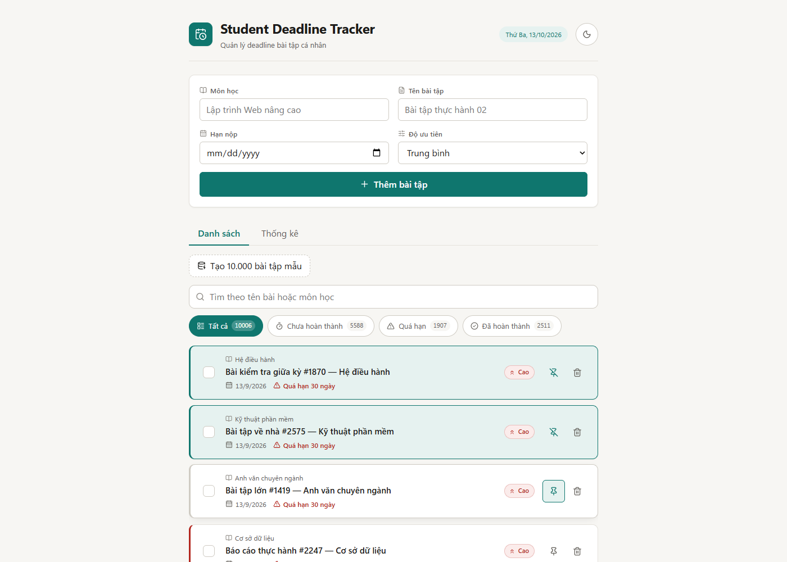

Cách đọc: bài #1870 (Hệ điều hành) và #2575 (Kỹ thuật phần mềm) đã ghim nên có nền xanh nhạt, viền xanh và biểu tượng ghim chuyển sang "bỏ ghim" (ghim gạch chéo); cả hai nằm trên cùng dù trong dữ liệu chúng không đứng đầu. Bài #1419 bên dưới chưa ghim nên vẫn dùng biểu tượng ghim thường. Ô đếm "Tất cả 10006" cho thấy đây là thao tác trên tập dữ liệu lớn.

**Hình A1-2** — cùng hai bài ghim, chuyển bộ lọc sang "Quá hạn" (1907 bài):

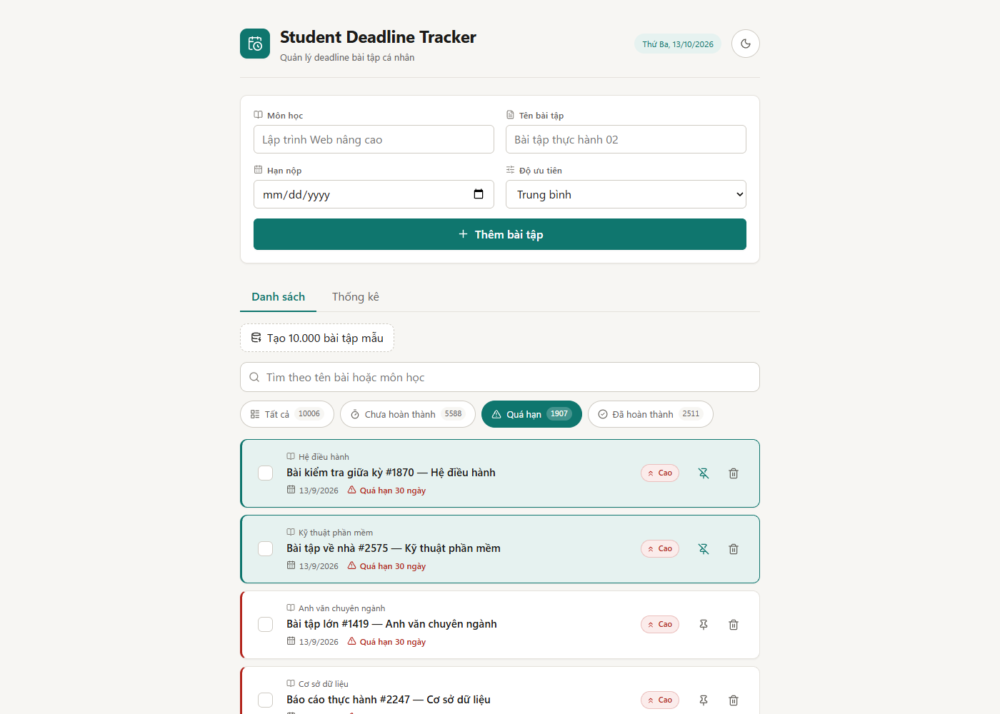

Cách đọc: hai bài ghim vẫn đứng đầu sau khi đổi bộ lọc, các bài sau là bài quá hạn thường (viền đỏ). Ghim áp dụng sau khi lọc: bài ghim không khớp bộ lọc thì không hiển thị. Thứ tự này cũng được kiểm trực tiếp trên DOM, kết quả ở `so-lieu/a1-ghim.json`.

### A2 — Theme (Context)

**Hình A2-1** — giao diện sau khi bấm nút đổi theme (nút chuyển thành biểu tượng mặt trời):

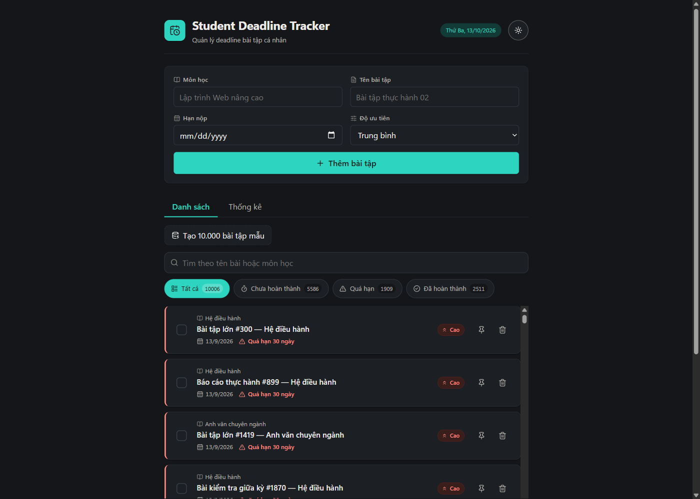

**Hình A2-2** — React DevTools Profiler, tab Flamegraph, ghi đúng một lần bấm đổi theme (1 commit):

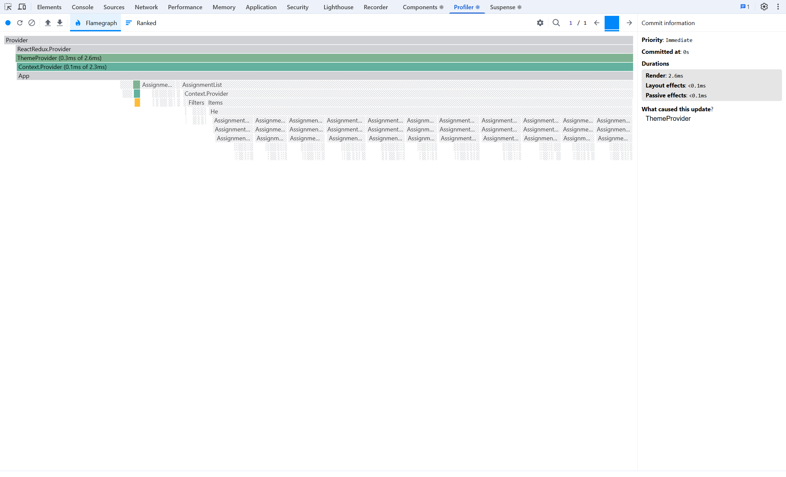

Cách đọc: mục "What caused this update?" ghi `ThemeProvider`, commit chỉ tốn 2,6 ms. Chỉ `ThemeProvider`, `Context.Provider` và một nhánh nhỏ của nút đổi theme (`ThemeToggle` → biểu tượng) có màu (có render). `AssignmentList`, `Filters`, `Items` và toàn bộ các `AssignmentCard` bên dưới là các thanh gạch chéo màu xám, nghĩa là **không render lại** trong commit này. Lý do: màu đổi bằng biến CSS theo `data-theme` nên chỉ cần `ThemeProvider`/`ThemeToggle` cập nhật.

**Hình A2-3** — cùng commit, xem ở tab Ranked (sắp theo thời gian render):

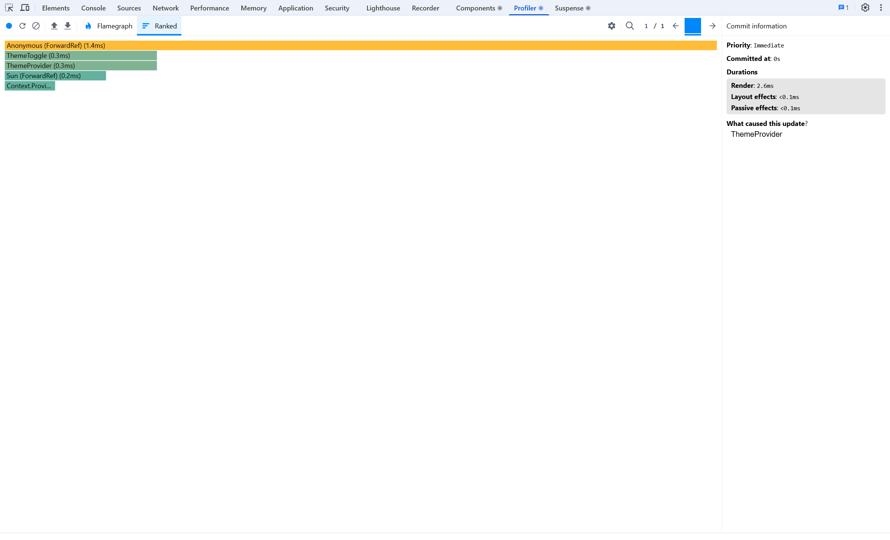

Cách đọc: danh sách chỉ có 5 thành phần (biểu tượng của nút, `ThemeToggle`, `ThemeProvider`, biểu tượng `Sun`, `Context.Provider`), không có `AssignmentCard` nào. Số đếm trong `so-lieu/theme/theme-commit.json`: `assignmentCardRenders = 0`.

### A3 — redux-logger

Trong bản dev (`npm run dev`), mỗi thao tác gọi API in ra console một cặp `pending` / `fulfilled`, mỗi action có `prev state`, `action`, `next state`:

**Hình A3-1** — thêm bài: `assignments/create/pending` → `assignments/create/fulfilled` (nguồn gọi `AssignmentForm.tsx:38`):


**Hình A3-2** — đánh dấu hoàn thành: `assignments/update/pending` → `assignments/update/fulfilled` (nguồn `useAssignments.ts:50`):

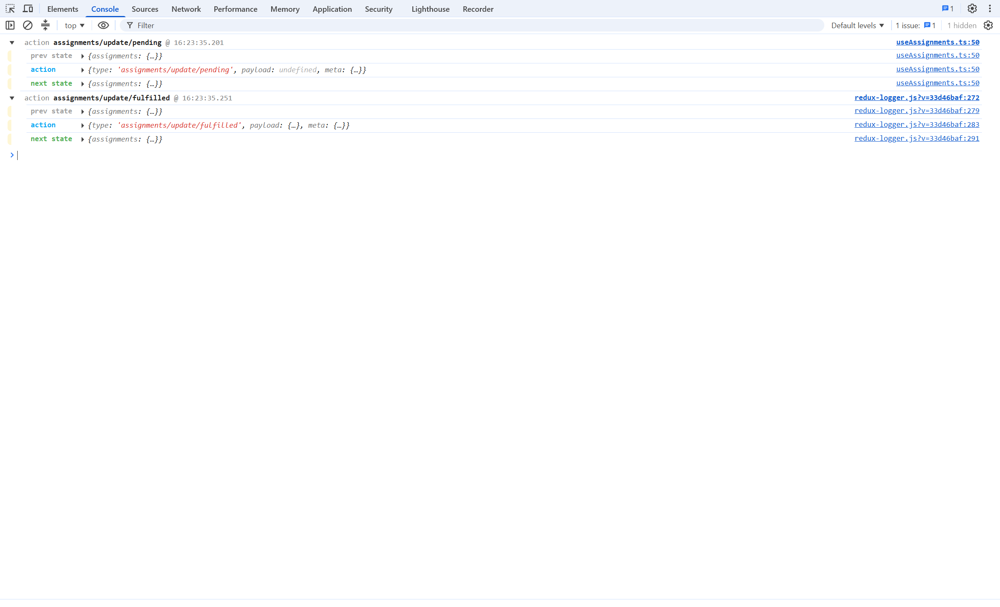

**Hình A3-3** — xoá bài: `assignments/delete/pending` → `assignments/delete/fulfilled` (nguồn `useAssignments.ts:58`):


**Hình A3-4** — bản production (`vite preview`), thực hiện lại cả thêm, cập nhật, xoá: Console trống, không có log redux-logger nào:

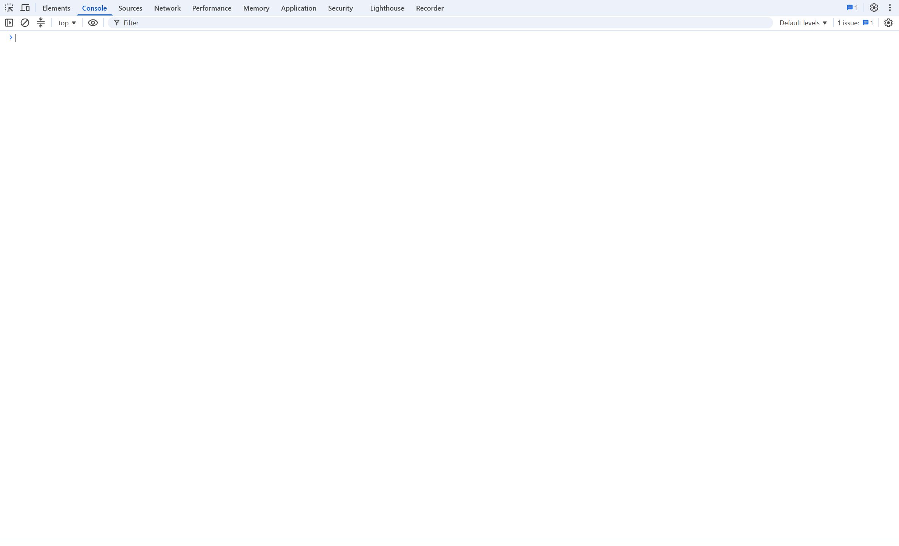

Cách đọc: A3-1 → A3-3 chứng minh logger hoạt động ở dev; A3-4 chứng minh nó bị tắt ở production. Kết quả bắt console tự động ở `so-lieu/logger-prod-check.txt` (0 message sau khi thao tác). Lưu ý: thư viện logger vẫn nằm trong bundle (import tĩnh để thấy ngay trong `store.ts`) nhưng không bao giờ được gắn ở production.

## 3. Phần B — Hiệu năng

**Workload:** 10.000 bài tạo bằng nút "Tạo 10.000 bài tập mẫu" (gọi `POST /api/assignments/bulk`; tạo xong thì nút khoá, nhãn "Đã tạo 10.000 bài") cộng 6 bài mock của BE = 10.006 bài. Hai làn đo dùng chung một BE đã seed nên cùng dữ liệu (fingerprint SHA-256 giống nhau: `so-lieu/fixture-phien.json`). Hàm sinh dữ liệu tự viết, PRNG cố định seed: `FE/src/features/assignments/mockData.ts`. Bản "trước" là tag `th02-baseline` (chưa tối ưu), bản "sau" là HEAD. React Compiler đã tắt để số đo "trước" có ý nghĩa.

**Kịch bản đo:** viewport 1400×1000, gõ `web` vào ô tìm kiếm (150 ms/phím), chờ 1 giây; React Profiler (dev, StrictMode). Lighthouse Mobile, mô phỏng throttling, 3 lần tuần tự, lấy trung vị, trên bản production `vite preview`.

**Định nghĩa "số render `AssignmentCard`":** Σ qua mọi commit, Σ qua mọi fiber `AssignmentCard` (khoá rootID + fiberID) có mặt trong `fiberActualDurations` của bản export Profiler (đếm cả fiber mount mới trong lúc ghi bằng cách replay `operations`). Đây là số *render đã commit*, không phải số commit, cũng không phải số lần gọi hàm. Component bọc `React.memo` hiện tên `Memo(AssignmentCard)` trong DevTools và được tính là cùng một card.

### Bảng so sánh trước/sau
| Chỉ số | Trước | Sau | Chênh lệch | Xem ở |
|---|---|---|---|---|
| Số render `AssignmentCard` khi gõ "web" (Σ commit × instance) | 3800 | 9 | −3791 (−99,8%) | B-2, B-3 / B-5, `render-count.json` |
| Số instance `AssignmentCard` khác nhau đã render | 1268 | 9 | −1259 (−99,3%) | B-2 / B-5, `render-count.json` |
| Số commit gốc khi gõ | 3 | 5 | +2 | B-2 (1/3) / B-5 (4/5), `render-count.json` |
| Tổng thời gian commit khi gõ | 3766,2 ms | 153,4 ms | −3612,8 ms (−95,9%) | B-3 / B-5, `render-count.json` |
| Số `AssignmentCard` trong DOM (10.000 bài) | 10006 | 11 | −9995 (−99,9%) | `dom-bundle.json` |
| Lighthouse Performance (Mobile, trung vị 3 lần) | 38 | 64 | +26 | `lh-1..3.json`, `lighthouse-median.json` |
| Lighthouse FCP | 1556 ms | 1510 ms | −46 ms | như trên |
| Lighthouse LCP | 12558 ms | 12817 ms | +259 ms | như trên |
| Lighthouse TBT | 27079 ms | 379 ms | −26700 ms (−98,6%) | như trên |
| Lighthouse CLS | 0,000 | 0,000 | 0 | như trên |
| Lighthouse Speed Index | 6932 ms | 3392 ms | −3541 ms (−51,1%) | như trên |
| JS tải ban đầu (gzip, 1 kB = 1024 B) | 107,51 kB | 111,82 kB | +4,31 kB (+4,0%) | `dom-bundle.json` |

Các cột "Xem ở" dẫn tới hình ở mục [Hình minh chứng Profiler](#hình-minh-chứng-profiler-gõ-web-trong-ô-tìm-kiếm) bên dưới hoặc tới file JSON trong `bao-cao/so-lieu/truoc` và `bao-cao/so-lieu/sau` (số Lighthouse không có ảnh panel, chỉ có JSON gốc, xem [Hạn chế](#5-hạn-chế-đã-biết)). Số render/commit tính từ `profiler-search.json`, bản export gốc của Profiler; bảng gộp ở `so-lieu/bang-so-sanh.md`.

### Hình minh chứng Profiler: gõ web trong ô tìm kiếm

Cùng một kịch bản, cùng 10.006 bài: gõ `web` rồi chờ 1 giây. "Trước" là bản `th02-baseline`, "sau" là bản đã tối ưu. Ảnh trang dùng để thấy giao diện thật, ảnh Profiler dùng để đọc số.

**Hình B-1 — Trước, giao diện sau khi gõ "web":**

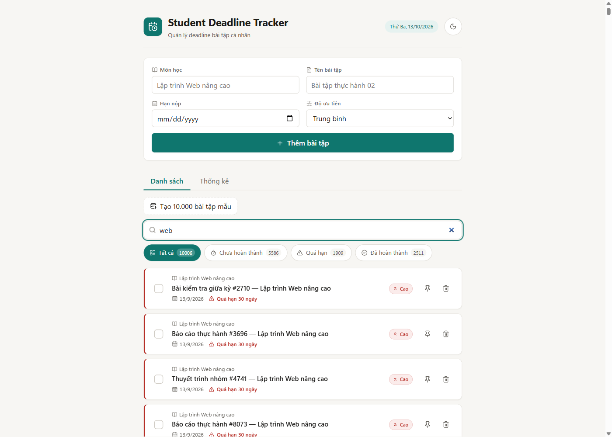

Danh sách kết quả hiển thị bằng cách render mọi card khớp trong DOM (nên cả trang cuộn dài, thanh cuộn của trình duyệt ở mép phải rất ngắn). Ô đếm vẫn ghi "Tất cả 10006".

**Hình B-2 — Trước, Profiler (Flamegraph), commit 1/3:**

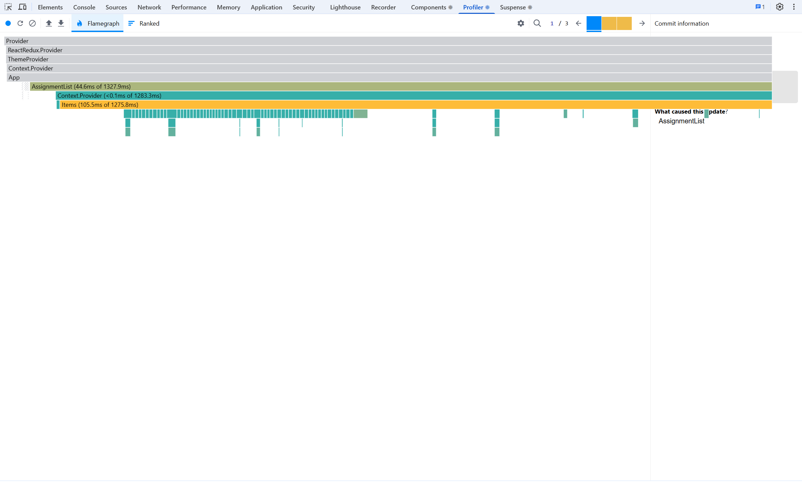

Cách đọc: thanh trên cùng "1 / 3" cho biết bản ghi có 3 commit (mỗi phím `w`, `e`, `b` một commit vì chưa debounce). Commit đang xem do `AssignmentList` gây ra, `Items` tốn 105,5 ms riêng của nó trên tổng 1275,8 ms; hàng trăm thanh nhỏ ở dưới là từng `AssignmentCard` bị render lại (không có thanh gạch chéo xám nào vì chưa có `React.memo`).

**Hình B-3 — Trước, Profiler (Ranked), cùng commit 1/3:**

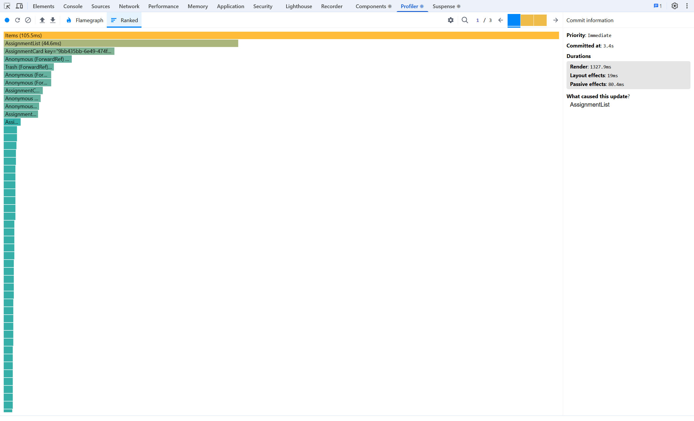

Cách đọc: cột bên phải ghi **Render: 1327,9 ms** cho riêng commit này, nguyên nhân `AssignmentList`; danh sách Ranked kéo dài vì rất nhiều `AssignmentCard` và con của chúng cùng render. Tổng 3 commit là 3766,2 ms, `render-count.json` đếm được 1268 instance, mỗi instance render 3 lần = **3800 render**.

**Hình B-4 — Sau, giao diện sau khi gõ "web":**

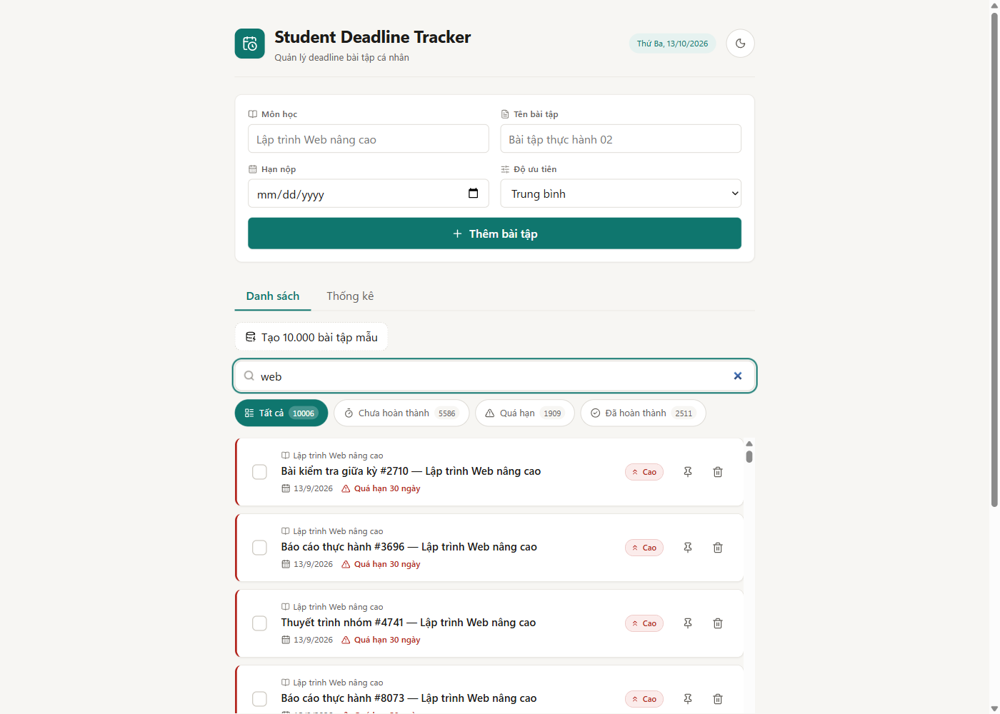

Danh sách kết quả nằm trong khung cuộn riêng (`react-window`, thấy thanh cuộn có mũi tên ở mép phải của khung danh sách); DOM chỉ giữ các card đang nhìn thấy cộng vài dòng đệm.

**Hình B-5 — Sau, Profiler (Ranked), commit 4/5:**

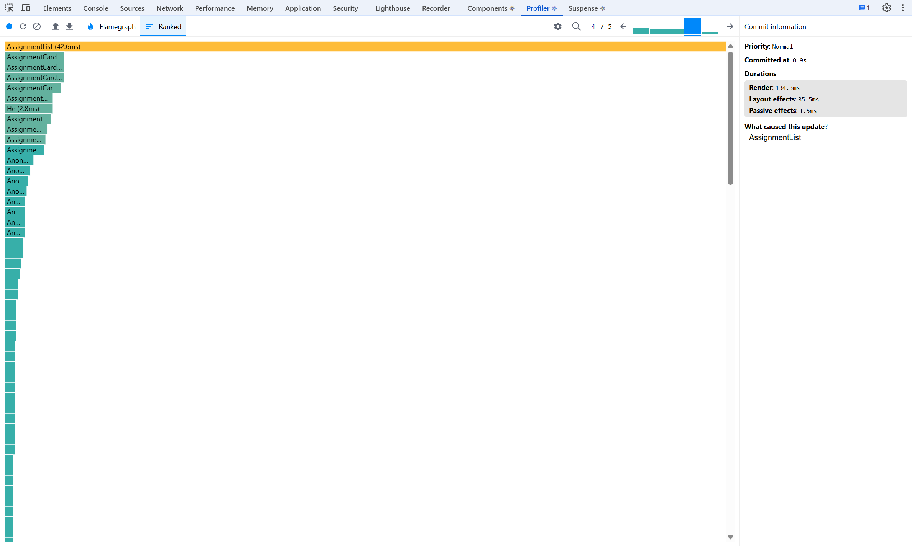

Cách đọc: bản ghi có 5 commit; ba commit đầu là ba phím (chỉ cập nhật ô nhập, không đụng card), commit 4 (đang chọn) là lần lọc sau 300 ms debounce: **Render 134,3 ms**, nguyên nhân `AssignmentList`, chỉ mount **9 `AssignmentCard`** (khớp 9 render ở bảng). Commit 5 nhỏ (0,6 ms) không render card nào. Tổng 5 commit = 153,4 ms.

**Hình B-6 — Lighthouse:** không có ảnh panel; số trước/sau nằm trong `so-lieu/truoc/lh-1..3.json`, `so-lieu/sau/lh-1..3.json` và `lighthouse-median.json` (3 lần chạy tuần tự, lấy trung vị). Điểm Performance 38 → 64 chủ yếu do TBT giảm từ 27079 ms xuống 379 ms.

### Hình minh chứng lazy loading: tab Thống kê

Hai ảnh dưới đây cùng một bản build production (`index-qpU9osfq.js`) với bộ lọc Network: Disable cache, No throttling. "Trước/sau" ở đây nghĩa là **trước/sau khi bấm tab Thống kê**, không phải trước/sau tối ưu.

**Hình B-7 — Trước khi bấm tab Thống kê:** 6 request (HTML, JS chính, CSS, icon, `assignments`, favicon), không có file `StatsPage`:

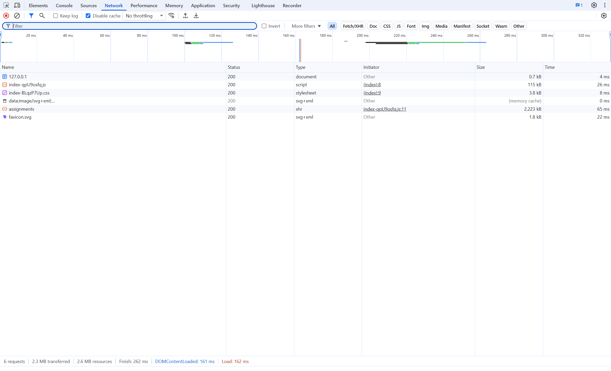

**Hình B-8 — Sau khi bấm tab Thống kê:** 7 request, xuất hiện thêm `StatsPage-JeQGMQLF.js` (0,9 kB, 5 ms, nguồn gọi từ `index-qpU9osfq.js:18`), chỉ tải sau khi bấm tab:

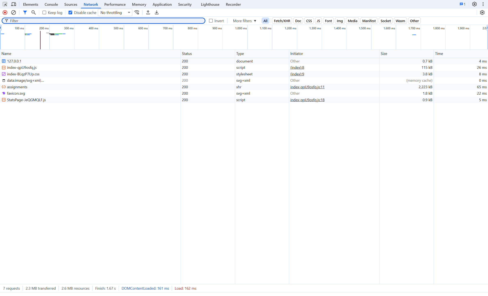

Số liệu tương ứng: `so-lieu/network-lazy.json`.

Nhận xét trung thực:
- Số commit gốc tăng (3 → 5) nhưng chúng rẻ: 3 commit đầu là 3 phím (chỉ cập nhật ô nhập, không đụng `AssignmentCard`), 1 commit là lần lọc sau 300 ms debounce (mount 9 card trong khung nhìn), 1 commit nhỏ ngoài thao tác không render card nào. Tổng thời gian commit giảm từ 3766 ms xuống 153 ms.
- **LCP không cải thiện** (12,6 s → 12,8 s): với mô phỏng mạng chậm, phần tử lớn nhất chỉ xuất hiện sau khi tải xong ~1,5 MB JSON của 10.000 bài; việc đó nằm ở mạng/BE, không phải ở render, nên tối ưu FE không đổi được.
- **JS ban đầu tăng nhẹ** (+4,3 kB gzip): `react-window` và `zustand` được thêm vào bundle chính, trong khi chunk Thống kê tách ra chỉ ~1,3 kB vì dùng chung `deadline.ts` với phần chính. Lazy-loading ở đây đúng kỹ thuật (xem Hình B-7, B-8 và `so-lieu/network-lazy.json`: `StatsPage-*.js` chỉ tải sau khi bấm tab) nhưng không giảm được JS ban đầu.
- Ghi Profiler: trang đã nạp xong mới ghi (không reload) vì mỗi lần nạp bản baseline 10.000 card mất ~90 s. Các commit không do thao tác (vd. tick đếm ngược 60 s của card) được tách riêng (`foreignCommits`/`foreignRenders` trong `render-count.json`); trong bản ghi cuối không có render `AssignmentCard` nào thuộc commit ngoài thao tác ở cả hai làn (làn sau có 1 commit ngoài thao tác nhưng không render card nào).

### 4 kỹ thuật tối ưu — đúng chỗ, không lạm dụng
| Kỹ thuật | Áp dụng ở đâu | Cố ý KHÔNG áp dụng |
|---|---|---|
| `React.memo` + `useCallback` | `AssignmentCard` (render hàng nghìn lần, props ổn định); `setFilter/toggle/remove/retry` trong `useAssignments`, context value bằng `useMemo` | `Filters`, `Empty`, `AssignmentForm`, `ThemeToggle`, `SeedButton`, `StatsPage`: ít phần tử, render rẻ hoặc props luôn đổi |
| `useDebounce(300)` + `useMemo` | Ô tìm kiếm; `visibleItems` chỉ tính lại khi `items`/`query` đã debounce/`pinnedIds` đổi | Form thêm bài; phép tính rẻ (nhãn, className) |
| Virtualization `react-window` | Danh sách bài (DOM còn ≤ 40 card, thực tế 8–11); `rowKey` theo id để đổi chỗ (ghim/lọc/xoá) không chuyển state/focus sang bài khác; chiều cao dòng cố định theo 2 bố cục (≤640 px và rộng), kiểm bằng trình duyệt ở 360/640/641/1400 px với tên bài rất dài | — |
| `React.lazy` + `Suspense` | Tab Thống kê | Form và danh sách (luôn hiển thị ngay) |

## 4. Phần C — Kiểm thử
Jest 30 + ts-jest + React Testing Library + user-event, môi trường jsdom. **23 test** (đề tối thiểu 12), 9 file:

| Loại | Số test | File |
|---|---|---|
| Unit | 10 | `deadline.test.ts` (5), `assignmentsSlice.test.ts` (4), `usePinStore.test.ts` (1) |
| Component | 6 | `AssignmentCard.test.tsx` (3), `AssignmentForm.test.tsx` (2), `StatsPage.test.tsx` (1) |
| Async (mock API) | 6 | `AssignmentList.test.tsx` (5: tải/lỗi-thử lại/ghim+tìm kiếm/không khớp/xoá lỗi), `SeedButton.test.tsx` (1) |
| Hook | 1 | `useDebounce.test.ts` (fake timers) |

Coverage `src/features/`: statements **91,22%**, branches 72,66%, functions 84,82%, lines 91,66%; `coverageThreshold` đặt 70% trong `FE/jest.config.ts` (đã thử hạ ngưỡng thử lên 99% → lệnh thoát mã 1, rồi trả lại 70%). **Hình C-1** — chạy `npm run test:coverage -- --verbose` trong PowerShell:

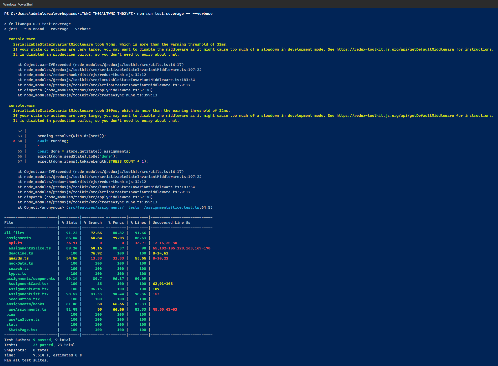

Cách đọc, từ trên xuống:
- Các khối chữ vàng đầu ảnh là `console.warn` của middleware kiểm tra state của Redux Toolkit (chậm hơn ngưỡng cảnh báo 32 ms) vì test nạp 10.000 bài; đây là cảnh báo, không phải lỗi.
- Bảng coverage, dòng **All files**: Statements **91,22%**, Branch 72,66%, Funcs 84,82%, Lines 91,66%, vượt `coverageThreshold` 70%. Các file thấp nhất: `api.ts` 35,71% (chỉ là lớp gọi `fetch`, test thay bằng mock API), `guards.ts` 54,54%, `useAssignments.ts` 81,48%; còn `deadline.ts`, `mockData.ts`, `search.ts`, `usePinStore.ts`, `StatsPage.tsx`, `SeedButton.tsx` đều 100%.
- Dòng cuối: **Test Suites: 9 passed, 9 total; Tests: 23 passed, 23 total**; thời gian 7,5 s.

Log gốc: `bao-cao/so-lieu/jest/jest-coverage.ansi.txt` (bản có màu), `jest-coverage.txt` (bản chữ thường).

## 5. Hạn chế đã biết
- Dữ liệu BE nằm trong bộ nhớ: restart BE là mất dữ liệu (và đổi dữ liệu mock vì dùng `Date.now()`); muốn seed lại phải restart BE.
- Virtualization: dòng ngoài màn hình bị unmount nên focus bàn phím mất khi cuộn khỏi dòng đó.
- Lighthouse dao động theo máy; số trong bảng là trung vị 3 lần trên cùng máy, cùng phiên, cùng dữ liệu. Chưa chụp được ảnh panel Lighthouse trong F12 (số liệu lấy từ Lighthouse CLI, JSON gốc trong `so-lieu/`).
- Số đo Profiler ở bản dev (StrictMode + overhead của DevTools) nên thời gian tuyệt đối chỉ để so sánh tương đối giữa hai làn.

## 6. Lịch sử commit
- `0ee21d6` — bản TH01 (nền để nâng cấp)
- Nền tảng và Phần A: tắt React Compiler, env boundary, store factory, hàm thuần deadline; ghim, theme, redux-logger
- `th02-baseline` — stress test 10.000 bài, tìm kiếm, tab Thống kê (chưa tối ưu)
- 4 commit tối ưu, mỗi kỹ thuật một commit: memo + useCallback → useDebounce + useMemo → react-window → lazy/Suspense
- Jest/RTL, 23 test, coverageThreshold
- `bao-cao/`: ảnh F12 và số liệu đo trước/sau
